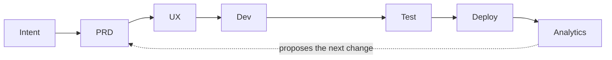

# AIDLC — autonomous software delivery, held at a human gate

AIDLC turns a plain-English request — *"add a health-check endpoint with a test"* — into a **reviewed pull
request**. A pipeline of specialist AI agents writes the spec, the design, the code and the tests, runs them
in isolation, and **stops for a human to approve every step that matters**. Nothing merges on its own.

It's a multi-tenant platform: a team connects a repository, brings their own model key, describes a change,
and watches a governed pipeline produce a PR they stay in control of.

## How it works



Each stage is run by a specialist agent and **held at a human gate** where it's risky (approve the spec,
confirm the merge, authorize the deploy). A fail-closed critic checks each stage before you ever see it, and
every decision lands on an append-only audit trail. Analytics reads production and proposes the next change —
a loop, not a line.

## Status

- **Live** on Kubernetes (HTTPS): marketing site, sign-in, onboarding, and a run console that produces real,
  human-gated pull requests.
- **Engine proven end-to-end** — a plain-English intent produced a draft PR (new endpoint + a regression
  test) and held at the merge gate; nothing was force-pushed.
- **Multi-tenant control plane** — strict tenant isolation at the data layer, envelope-encrypted secrets
  (injected just-in-time, destroyed with the run), short-lived repo-scoped GitHub tokens, usage metering and
  prepaid-credit billing, persisted on a managed cloud database.
- **CI/CD** — protected `main`, PR-gated CI (typecheck + tests + chart lint + image build), auto-deploy on
  merge.

## What's interesting technically

- **Governance that holds** — fail-closed verifiers on money- and migration-touching changes, a requirements
  (EARS) coverage gate, RBAC approvers, an append-only audit. Nothing grades its own work.
- **Any model, per stage** — bring your own key; route a frontier coder to Dev and a cheap model to the
  critic. Admins can cap spend per stage.
- **Tenant isolation by construction** — a tenant context can only ever touch its own data; cross-tenant
  reads return nothing, and creates are stamped server-side.
- **Secrets never persist** — AES-256-GCM envelope encryption at rest, decrypted just-in-time into a run.

## Quick start

```bash
npm install
npm run build   # tsc --noEmit (strict)
npm test        # foundation tests — zero external deps
npx tsx src/http/server.ts   # serves the app on :8787 (in-memory store, no setup)
```

## Stack

TypeScript / Node · managed cloud database · Helm on Kubernetes · External Secrets → cloud vault ·
Traefik + cert-manager for HTTPS · GitHub Actions CI/CD.

---

*Status: early, actively built. The security-critical core (tenant isolation, secrets, gating) is real and
tested; some integrations (full SSO, per-run microVM isolation) are typed seams on the roadmap.*
