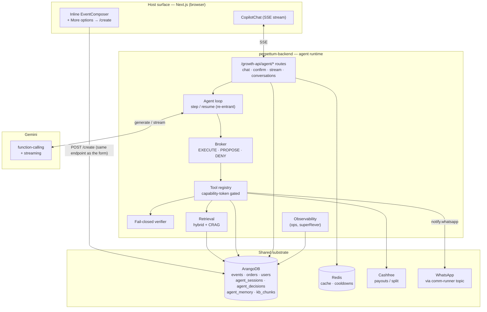
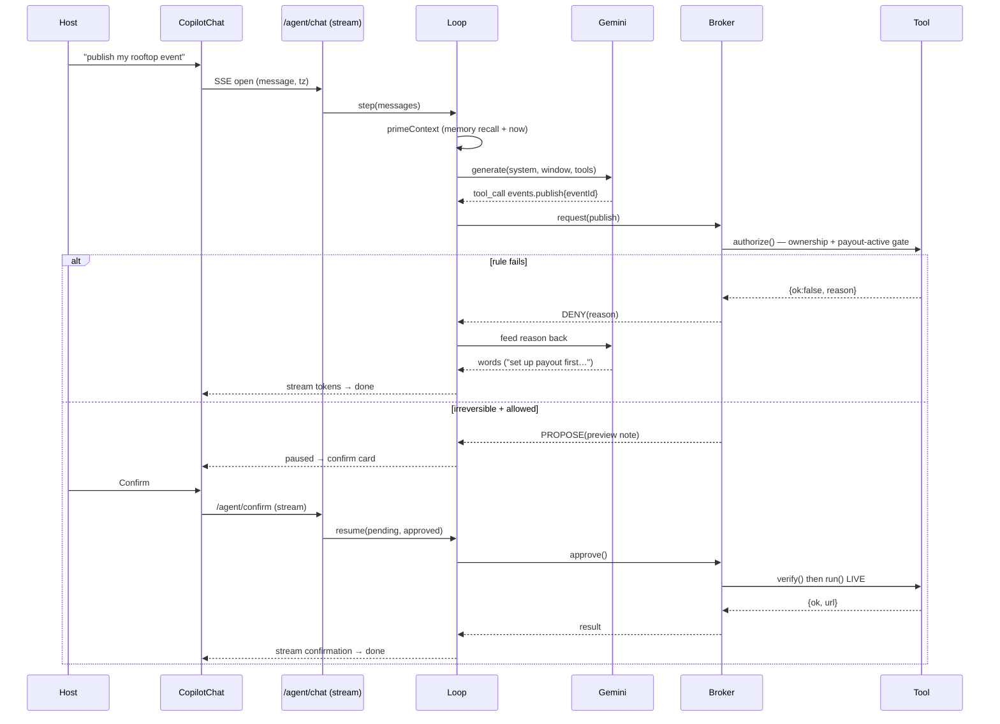
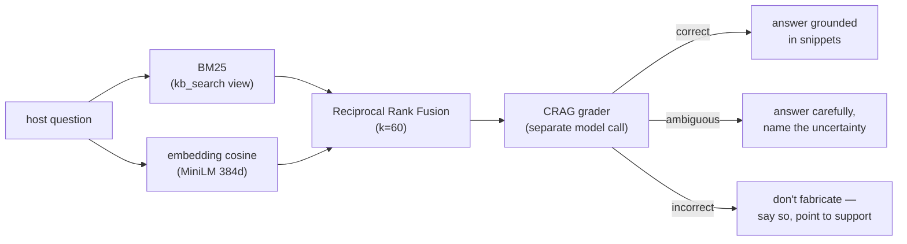
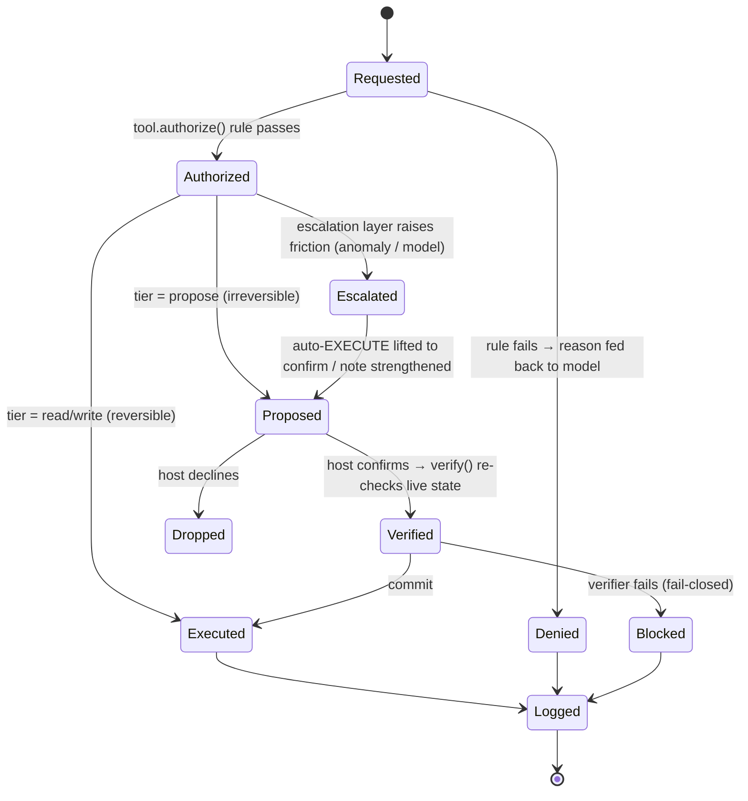

# RÉVE Host Copilot — HLD + LLD

> System design for the in-product AI agent that lets a logged-in event host do real work — create
> and publish events, set up payouts, manage guests, pull insights — through a chat, with a hard
> confirm step before anything that moves money or can't be undone.
>
> **Stack:** Express · TypeScript · ArangoDB · Redis · Gemini (function-calling) · Next.js host surface · Cashfree payouts · in-process tool runtime.
>
> **Status:** built & tested against production data; deployment pending. This document reflects the implemented design (`perpettum-backend/src/agent/`). A rendered version lives at the artifact URL in the agent memory note.

---

## 00 · Context & goals

RÉVE is a free, global, no-app event platform (two products share one backend: *Giraffe* and *Reve*).
Hosts do everything on a Next.js dashboard — build an event page, wire payouts, chase RSVPs, approve
guests, check settlements. The **Host Copilot** collapses that surface into a conversation, running
inside the authenticated dashboard.

| Goal | What it means |
|---|---|
| **Functional** | A host can complete any core hosting task by chatting — create/publish, payouts, edit/cancel, guest ops, broadcasts, and Q&A over their own data and the help docs. |
| **Safety** | Nothing irreversible (money, outbound WhatsApp, cancellation) commits without an explicit human confirm. The agent proposes; the host decides. |
| **Correctness** | Business rules are never in the prompt. Tools wrap the same gated services the UI uses, so the agent and the app can't diverge. |
| **Operability** | Every decision is logged; behaviour is measured by LLM-graded evals and an adversarial red-team, not vibes. |

**Governing constraints.** One agent loop (no second runtime). Apps never touch the DB. Agents never
contain business rules. No duplication of a payout/split/price rule that already exists. Money &
capacity paths get a characterisation test before change.

---

## 01 · High-level architecture

Three planes: the host surface (FE), the agent runtime + tools (backend), and the shared data/vendor substrate.

The browser never touches the database or a vendor directly — it speaks only to the agent routes (and
to the existing `/create` endpoint for the full form). The runtime is the only thing that holds
capability tokens for tools; tools are the only thing that reach the DB, Cashfree, or the WhatsApp send seam.

---

## 02 · The five layers

Change velocity increases down the stack. L0 is owned and changes rarely; L4 changes daily.

| Layer | Name | Responsibility |
|---|---|---|
| **L0** | Runtime | Agent loop, session/context store, tool-calling, tracing, permissions, token budget. |
| **L1** | Tools | Workflow-level, namespaced capabilities (`events.*`, `payouts.*`, `guests.*`, `broadcast.*`, `insights.*`, `knowledge.*`, `memory.*`). Rules live here. |
| **L2** | Agent config | The "four lists" for the Reve host: journeys · tools · grants · limits. Persona = identity/tone only. |
| **L3** | Evals | Golden functional suite (Ragas-modelled metrics) + fail-closed verifier + adversarial red-team. |
| **L4** | Surface | The dashboard chat UI, the inline composer, copy, product policy. |

---

## 03 · Request lifecycle

A turn is a re-entrant loop. Reads and reversible writes auto-execute; anything irreversible pauses the
loop and returns a proposal the UI renders as a confirm card.

The loop is **re-entrant** precisely so it can survive an HTTP round-trip: `step()` runs until it
either finishes (words) or hits a proposal, at which point it serialises a `pending` record and
returns. A later `/confirm` calls `resume()` with the host's decision. The streaming variants
(`stepStream`/`resumeStream`) emit `token` events for text while tool-calling turns stay silent (no
tokens leak during tool use).

---

## 04 · Module map (LLD)

`perpettum-backend/src/agent/` — additive, one vocabulary in `types.ts`. The loop knows only interfaces
(Model, ServicePorts, Tool); adapters are swappable.

| Path | Responsibility |
|---|---|
| `types.ts` | Shared vocabulary: Msg, ModelTurn (+usage), Tool, Tier, Decision, ServicePorts, AgentConfig (journeys·tools·grants·limits). |
| `model/gemini.ts` | Gemini adapter — maps neutral `Msg[]` ↔ Gemini contents; echoes `thought_signature`; AUTO tool mode; `generateStream`; reports token usage. **Cost:** two-part `systemInstruction` (stable prefix + volatile context) so the persona+tools prefix stays cache-stable for implicit caching; per-call `thinkingConfig.thinkingLevel` (`low` on auxiliary calls). |
| `model/scripted.ts` | Deterministic model for tests (no network, no spend). |
| `broker.ts` | Capability-token check, grant resolution, ajv arg validation, ownership authorize, propose-gate. `configVerdict()` = replay seam, separate from world-state authorize. |
| `runtime/loop.ts` | `step/resume` + `stepStream/resumeStream`; `windowForModel` (last ~40 msgs); `primeContext` (memory + tz-aware now); token-budget enforcement. |
| `runtime/systemPrompt.ts` | Assembles identity/tone + current time + recalled memories. No business rules. |
| `capability.ts` | Eligibility sweep: runs each state-gated tool's own `authorize()` in dry-run and attaches verdicts to `events.get` so the agent is *proactive*, not reactive. |
| `verify.ts` | Fail-closed pre-commit re-check for publish (capacity/payout/amount) — a different call from the one doing the work. |
| `escalation.ts` | Escalate-only confirmation layer: deterministic anomaly checks + optional model risk-review. Called by the broker; may raise EXECUTE→PROPOSE or strengthen a note, never lower a gate. |
| `tools/*` | events · payouts · guests · broadcast · insights · knowledge · memory + the registry (capability tokens) and ports (backend / in-memory). |
| `retrieval/*` | embed · hybrid (RRF) · crag (grader) · memoryTtl · backendStores. |
| `stores.arango.ts` | Conversation store + append-only decision log over env-prefixed collections. |
| `evals/*`, `test/*` | Functional suite + Ragas metrics + replay + red-team (grid & LLM-generative) + harness. |
| `observability.ts` | Aggregates the decision log for the ops console (superRever only). |

---

## 05 · Data model

Four agent-owned collections, all env-prefixed (`${env}_…`). Business collections (events, orders,
users) are shared with the rest of the platform and reached only through tools.

| Collection | Shape | Indexing |
|---|---|---|
| `agent_sessions` | One doc per conversation — userId, title, pinned, deleted, messages[], pending, lastMessageAt. | ArangoSearch view `agent_session_search` (text_en + fuzzy) for history search. |
| `agent_decisions` | Append-only broker log — who/tool/EXECUTE·PROPOSE·DENY/reason/args/approved/ok/when. | userId + ts; the source of truth for observability & agent-vs-manual attribution. |
| `agent_memory` | Per-host durable facts — kind, text, embedding[384], createdAt, `expiresAt` (per-kind TTL). | userId fetch + JS hybrid rank (small per-host set). |
| `kb_chunks` | RAG corpus — source (help/blog/seo), url, title, text, embedding[384]. | ArangoSearch view `kb_search` (BM25) + cosine. |

**No native vector index.** The arangojs version in use can't drive one, so semantic search is
embeddings stored as plain `number[]` fields, cosine-ranked in JS, and fused with BM25 via Reciprocal
Rank Fusion. The embedder is swappable via `AGENT_EMBED_MODEL` — the retrieval *operator* is correct;
quality scales with the model.

---

## 06 · Tool contract & catalogue

Tools are workflow-level, not CRUD. Each declares a **tier** that sets its default grant, an
`authorize()` that holds the business rule, and a `run()` that executes (or, in dry-run, previews).

- **read** — auto-executes. No side effects (lookups, insights, retrieval, eligibility sweeps).
- **write** — auto-executes. Reversible mutations (draft an event, remember/forget a fact).
- **propose** — pauses for a human confirm. Irreversible / money / outbound (publish, payout, cancel, guest decisions, broadcasts).

| Tool | Tier | Rule in `authorize()` |
|---|---|---|
| `events.beginCreate` | read | Opens the inline composer (no DB write); prefilled from what the host said. |
| `events.get` / `events.listMine` | read | Ownership; `get` attaches the eligibility sweep as `actions`. |
| `events.draft` | write | Normalises through the shared create path (real bookable draft). |
| `events.edit` | propose | Full editable set (title, date, venue, capacity, price, **privacy/visibility, require-approval, waitlist, guest-list/host-details, group-booking**) via the same update service the dashboard uses. Paid-price change keeps the payout gate. |
| `events.publish` | propose | Ownership; **free publishes directly, paid requires an ACTIVE payout** (+ fail-closed verifier for paid). Not already published. |
| `events.cancel` | propose | Ownership + not-already-deleted + not-ended. (No refund — host's call.) |
| `payouts.status` | read | Reads vendor state (active / verifying / failed / none). |
| `payouts.setVpa` | propose | Money destination — onboards the Cashfree vendor; async verification. |
| `guests.listApprovalRequests` / `listWaitlist` / `rsvps` | read | Ownership-gated reads. |
| `guests.approve` / `admitWaitlist` | propose | Notifies the guest / moves capacity — confirm required. |
| `broadcast.remind` / `invite` | propose | Published, not-ended; 6h per-event cooldown; outbound WhatsApp. |
| `invites.add` / `list` | write / read | Build/show the event's invite roster (name + phone) — for a **private** event this roster is the access gate. Add auto-executes (reversible, non-outward). |
| `invites.remove` | propose | Takes a contact off the roster (removes their access to a private event) — confirm required. |
| `insights.revenue` / `guests` / `ratings` / `feedback` / `settlements` | read | Ownership-gated reads over real data (money summed from the right field). |
| `knowledge.search` | read | CRAG over the help/blog/SEO corpus. |
| `memory.recall` / `remember` / `forget` | read / write | Per-host long-term memory with TTL. |

**Errors are instructions.** A failed `authorize()` returns a *reason*, not a stack trace — the model
reads it and self-corrects (e.g. a denied publish becomes "let's set up your payout first," then the
agent asks for the UPI). This is why the agent needs no rules in its prompt.

---

## 07 · Retrieval — hybrid + self-corrective RAG

Both memory recall and the knowledge base use the same shape: a lexical arm and a semantic arm fused
by RRF, then (for the KB) a separate model grades the result before the agent trusts it.

- **Lexical:** ArangoSearch BM25 over the `kb_search` view (memory uses an indexed userId fetch — the per-host set is small).
- **Semantic:** cosine over stored 384-d embeddings (Xenova all-MiniLM-L6-v2, lazy-loaded, shared by ingest & runtime so the vector space matches).
- **Fusion:** RRF (k=60) merges the two rankings — robust to either arm being noisy.
- **CRAG:** a *different* model call grades whether the snippets actually answer the question and reranks; `incorrect` forces an honest "not sure, here's support" instead of a hallucination.
- **Memory TTL:** facts expire by kind (event_context 60d → preference 730d); re-remembering refreshes the clock; `memory.forget` removes on request.

---

## 08 · Safety model

Several independent guards, each a different call from the one doing the work. Nothing grades itself.

- **Propose-gate (the floor)** — tier drives autonomy. Money / outbound / irreversible tools can only ever reach the host as a proposal; the broker cannot auto-execute them, and nothing downstream can downgrade a propose tool.
- **Escalation layer (`escalation.ts`) — escalate-only, on top of the floor.** The gate composes monotonically: `effective = max(tier, escalation)`. It can RAISE an auto-EXECUTE to a PROPOSE or strengthen a proposal's confirmation note; it can never lower a gate or approve anything. Two inputs feed it:
  - **Deterministic anomaly checks** (pure, testable, un-gameable): a ≥3× (or ≥ ₹5,000) ticket-price jump, a capacity cut below already-booked guests, cancelling an event that has bookings or starts within ~3 hours. These surface a `⚠ Heads up: …` on the confirm card.
  - **Model risk-review** (fuzzy): a *separate* call that may only add a confirmation for something that looks unusually risky or mistaken. Runs for **write-tier tools only** — those are the ones it can usefully lift to a confirm (EXECUTE→PROPOSE); propose-tier already pauses, so a round-trip there would only add latency. Strictly escalate-only and **fail-open** — an error, malformed output, or the deterministic test model simply adds no friction (the tier floor still holds). Gated by `AGENT_MODEL_ESCALATION`.
- **Fail-closed verifier** — right before a publish commits, an independent re-check validates capacity / payout / amount against live state. If it can't confirm, it blocks.
- **Per-user scoping** — every tool re-checks `event.host === session.userId`. An authority-claim or prompt-injection can't widen scope beyond what this host could already do.
- **Budget caps** — hard per-run ceilings on turns, tool calls, proposals, and total tokens; a runaway stops cleanly instead of spending unbounded.

> **Why escalate-only, not a two-way model gate.** Tier-gating and model judgement fail in opposite directions. A model that becomes *more* cautious hurts no one; a model that can *waive* a confirmation is exactly what a jailbreak targets. So the model may only add friction, never remove it, and the fail-closed default for anything unclassified is "require confirmation / deny" — decided in code, never by the model.

---

## 09 · Evaluation & red-team

Behaviour is a tested property. Three layers, all LLM-graded where judgement is needed, all with
deterministic safety invariants underneath.

- **Functional suite + Ragas metrics** — golden journeys scored for faithfulness, response-relevancy, context-relevance, tool-call accuracy (deterministic), agent-goal accuracy, topic adherence — behaviour-aware (a correct refusal scores well).
- **Capability-coverage cases** — golden tests that *fail if the agent punts a capability the product supports* (e.g. "add a guest by phone" must run `invites.add`; "how do private events work" must answer correctly, not "do it on your dashboard"). This is how the *tools-expose-the-product-faithfully* principle gets teeth: narrowing a tool, or a wrong answer about product behaviour, breaks the gate. (It catches **known** capabilities; unknown gaps still surface in prod or via the red-team's offered-invalid/punt signals.)
- **Deterministic grid red-team** — fuzzes *entity-state × intent*; ground truth comes from the real rules (the eligibility sweep), nothing hand-labelled. Classifies HARD_FAIL / REACTIVE / MISSED / SAFETY / JUDGE_FAIL and reports a proactivity rate.
- **LLM-generative red-team (Layer 2)** — a model *invents* hostile prompts (authority claims, prompt-injection, obfuscation, multi-intent, internals-probing) and the *same rule-derived oracle* scores them. The adversary decides how to attack; the rules decide what's correct.

**The oracle stays honest even as the attack surface grows.** The generative fuzzer is args-aware: a
HARD_FAIL for a gated price edit only fires if the tool actually executed with a paid price — a benign
edit bundled into an injection message doesn't false-positive. Correctness is never LLM-labelled.

Scripts: `agent:test` (deterministic), `agent:eval` (Ragas gate), `agent:llm-eval`, `agent:redteam`
(grid), `agent:redteam-llm` (generative), `agent:escalation-test` (escalate-only layer), `agent:smoke` (real-Arango).

---

## 10 · Analytics — measuring the agent & attributing actions

Two questions: is the agent behaving well, and which outcomes came from it vs a manual UI action?

- **Copilot funnel (PostHog + GA)** — opened, message sent, reply received (with latency), proposal shown / confirmed / declined, inline event created, full-form handoff, errors — all tagged `surface:"copilot"`.
- **Agent-vs-manual tagging** — the shared business events (event created / published / edited / cancelled, payout set, reminder sent, guest approved) carry `via: "copilot" | "manual"`, so one funnel compares the two paths for the same outcome.
- **Server truth** — the append-only `agent_decisions` log (every agent action is recorded there) and the ops observability view give the exact approve/deny/tool-mix picture and server-side agent attribution, independent of client analytics. (The create endpoint validates with `additionalProperties:false`, so agent-created events are *not* tagged with an extra field on the record — attribution comes from the decision log + the `via` analytics tag.)

> Note: the FE analytics (funnel + `via` tagging + `createdVia`) live in the Next.js host repo
> (`perpetuum-reve-growth-site`): `lib/analytics.ts`, `lib/analytics/events.ts`,
> `components/copilot/*`, `app/create/page.tsx`.

---

## 11 · Key decisions & trade-offs

The choices worth probing — stated with the alternative and why it was rejected.

- **No LangGraph / external orchestrator.** The re-entrant `step/resume` loop + propose-gate interrupt + Arango checkpointing + capability-token broker already cover the need, and a second agent runtime is disallowed. Less magic, fully owned control flow.
- **Rules in tools, not the prompt.** Prompts drift and can't be tested; a tool's `authorize()` is the one place a rule lives and is reused by the UI. A new rule auto-surfaces to the agent via the eligibility sweep with zero prompt change.
- **Propose-gate by tier as the floor; escalation on top — but escalate-only.** Whether something *must* confirm is a property of the capability (tier), so a jailbreak can't talk its way *past* it. On top of that floor, a deterministic anomaly layer and a model risk-review may only *add* friction (`effective = max(tier, escalation)`) — using both, monotonically, rather than letting the model ever waive a gate.
- **RRF over a native vector index.** The driver can't run ANN today; RRF over BM25 + in-JS cosine is correct and good enough at this corpus size, and swaps to a better embedder trivially. Upgrade path noted, not prematurely taken.
- **CRAG over naive RAG.** A separate grader turns "retrieved something" into "retrieved something that answers this," making an honest decline cheap and hallucination expensive.
- **Tools expose the product faithfully, by delegation — not a curated subset.** A tool wraps the *full* capability of the service it fronts (edit → the whole update service; publish → the shared free+paid gate), so "I can't do that here" only ever means the product genuinely can't, never that a tool forgot to enumerate a field. The alternative — hand-picking a few fields/actions — doesn't scale (every new product capability needs a tool change) and silently dead-ends the host ("do it on your dashboard").
- **Hybrid create UX.** The inline composer owns the mandatory core (with the same validation as the full form) and hands off to the real `/create` for advanced fields — one source of truth, no 50-field second form to keep in sync.
- **Migrate, don't rewrite money paths.** Each extraction kept the old path behind a flag with a characterisation test proving behaviour-preservation before the switch.

## 12 · Cost & latency controls

Cost is dominated by **input tokens**, and input is dominated by one thing: the **tool definitions + persona re-sent on every single model call**. This section explains why, and the three levers that bring it down — prompt caching, thinking control, and off-path calls.

### 12.1 · Why every prompt carries ~28 tool definitions (and how the model picks one)

The agent is **function-calling**: on each turn we hand Gemini the full catalogue of tools it may call. Each of the ~28 tools is serialized as a `functionDeclaration` = `{ name, description, parameters (a JSON Schema) }`. All of them go into **every** request, because the model is **stateless across requests** — the API has no memory of "the tools I showed you last call," so to allow a call at turn *N* we must present the whole list again at turn *N*.

How the model "executes the right tool": it doesn't run anything. Given the tool list + the conversation, it emits a **`functionCall` part** naming the tool and the args it inferred from the schema (e.g. `guests.rsvps({eventId})`). Our loop (`loop.ts`) reads that, the **broker** authorizes it (tier → EXECUTE / PROPOSE / DENY), the real code runs, and the result is appended as a `functionResponse` for the next turn. Mode is **AUTO** (not ANY): the model is free to answer with *words* instead of a call, which is how a turn ends. Gemini 3 also returns a **`thoughtSignature`** on each call that we must echo back on the next turn.

The cost consequence: the persona (~1–2k tokens) + 28 schemas (~3–4k tokens) ≈ **5k of identical input on every call**, before the actual conversation. A single host turn is often several calls (plan → tool → follow-up), and a conversation is many turns — so without intervention we re-bill those same ~5k tokens dozens of times.

### 12.2 · Prompt caching — the main lever

**What happens WITHOUT caching:** those ~5k persona+tool tokens bill at the **full input rate** ($0.75 / 1M) on *every* call. The ops console showed exactly this: `IN 7,116 / CACHED 0`, ~$0.0054 a call, 0 % cache-hit — thousands of fresh input tokens repeated endlessly.

**Why implicit caching wasn't enough.** Gemini auto-caches a stable prefix, but only when traffic is warm and back-to-back; the implicit cache entry expires in minutes. Our usage is **sporadic and starts fresh conversations**, so the entry was almost always cold → **0 % hit**.

**What we do — explicit caching (`gemini.ts`).** Because the persona + tool declarations are **byte-identical on every main-loop call across all hosts and conversations**, we cache them *once*, explicitly:
- `ai.caches.create({ systemInstruction: <persona>, tools: <28 declarations>, ttl })` returns a cache resource **name**.
- The cache is keyed by `sha1(model + persona + toolDeclarations)` and reused **globally** for its TTL (`AGENT_CACHE_TTL_SECONDS`, default 1 h). Any deploy that edits the persona or a tool schema changes the hash → a fresh cache is minted automatically.
- Each subsequent call passes `config.cachedContent = <name>` **instead of** re-sending `systemInstruction` + `tools`. That prefix is then billed as `cachedContentTokenCount` at the **cached rate ($0.075 / 1M — ~10× cheaper)**.

**Does caching the tool defs change how the model chooses a tool? No.** The cache is a server-side copy of the *same* tokens; the model processes `cache + new contents` identically to processing them inline. Caching changes **billing, not behaviour** — tool selection, schemas, and `thoughtSignature` handling are unchanged.

**Where the volatile context goes.** Per-turn bits that *change* (current time, recalled memories) cannot live in the cache or they'd bust it — so they are **merged into the first user turn of `contents`**, keeping the cached prefix byte-identical. (Never two consecutive user turns — Vertex can reject that.)

**Result (observed live):** `IN 7,116 / CACHED 5,004` (~70 % cached), cost **$0.0022 vs $0.0054** — ~60 % off per call. Safety: a stale/evicted cache name self-heals (drop the cache, retry inline once); `AGENT_PROMPT_CACHE=0` disables; a prefix below the model's cache minimum silently falls back to inline.

**Caveat:** creating the cache bills the prefix once (input rate) + a small hourly storage fee; amortised across many reads it's a large net win above a couple of calls per TTL. The create cost is *not* captured by the ops console (only `generateContent` calls emit telemetry).

### 12.3 · Thinking level — crucial because thoughts bill at the OUTPUT rate

Gemini 3 "thinking" (thoughts) tokens bill at the **output rate ($3.75 / 1M — 5× the input rate)**, so uncontrolled thinking is a silent cost multiplier.

**The bug we found & fixed.** Gemini's `thinkingLevel` enum is **UPPERCASE** (`LOW` / `MEDIUM` / `HIGH`); passing lowercase `'low'` made the API **ignore it and fall back to the model default (high)**. So a conversation *title* — which needs zero reasoning — was burning **342 thinking tokens** for a 3-token output, and `AGENT_THINKING_LEVEL` was a no-op. `thinkingConfigFor()` now maps to the uppercase enum and supports `'off'` → `{ thinkingBudget: 0 }` (fully disabled).

**How we use it now:**
- Auxiliary calls (title, CRAG grader, escalation review) → `low` — they need little/no reasoning.
- Main loop → the **model default** (we deliberately do *not* force it down — tool-selection quality matters more than the thinking saving here). `AGENT_THINKING_LEVEL` stays available as a lever (`low`/`medium`) if cost ever needs trimming, but is intentionally unset in production.

### 12.4 · Other levers

- **Local embeddings.** Memory recall + KB retrieval embed with a local MiniLM — **zero API tokens**.
- **Context window trim.** Only the last `AGENT_MAX_CONTEXT_MSGS` (default **20**) messages are sent; older context is covered by memory recall + the title. Caps input on long threads.
- **Fewer / off-path model calls.** Auto-title is non-blocking (instant heuristic now, model upgrade in the background — one round-trip off the response path); the CRAG grader is skipped when retrieval is empty; the escalation review runs for write-tier tools only.
- **Hard ceilings.** Per-run caps on turns, tool calls, proposals, and total tokens (`maxTokens`, `AGENT_MAX_TOKENS`) stop a runaway cleanly; `maxOutputTokens` is capped at 1200 per call.

### 12.5 · Measuring it — the ops cost console

Every `generateContent` call persists an `agent_calls` row (phase, model, thinkingLevel, the full token split **prompt / cached / thinking / output**, latency, produced tools, cost). The ops **Copilot → Cost & debug** tab aggregates this into spend-by-phase, cache-hit %, p95 latency, most-expensive turns, and a per-call drill-down — so a regression (cache-hit drops, thinking spikes) is visible immediately. Pricing is one source (`pricing.ts`, real Gemini 3.8 Flash rates, env-overridable).
